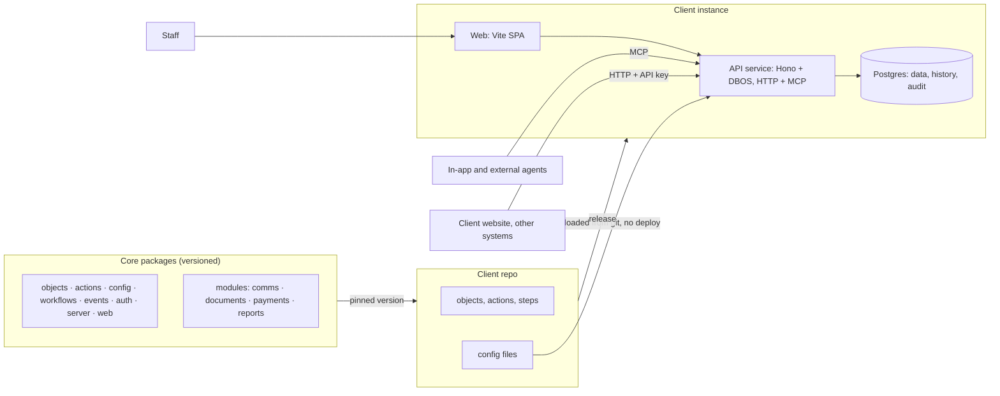
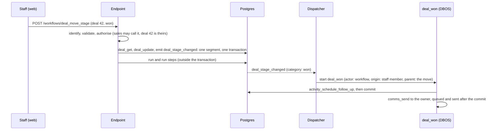

# System design

A simplified design for the factory core: how the repos are structured, what the database starts with, what each part of the system does, how the parts work together, and how agents use it both to build systems and to serve the people who use them.

Status: design. Names (`Factory`, `@workspace/*`, `fx`) are placeholders. Examples use the CRM example system.

---

## 1. The big picture

A client system is a small repo on top of versioned core packages. It deploys as three things: an API service, a static web front end and a Postgres database.



Three rules hold everything together:

1. **Every call goes through an endpoint, and there are only two kinds:** object endpoints, generated for every object, and published workflows. The web surface, agents and external systems call the same endpoints, and workflow steps run the same actions, so role rules, validation, history, events and the trace always apply.
2. **Every definition lives in the repo.** Objects, actions and code workflows are TypeScript. Config, including client workflows, is YAML files. The database holds data, never definitions.
3. **Everything is derived one way.** Definitions produce the schema, the API, the screens and the agent tools. Nothing is maintained twice, so nothing can drift.

Names are snake_case and identical on every surface: `deal_move_stage` is the workflow file, the URL, the MCP tool and the name in the trace (decision 0047).

---

## 2. Repos

### The core monorepo

```
factory/
  apps/
    web/          the staff web surface (TanStack Start in SPA mode, shadcn)
  packages/
    ui/           shared shadcn components used by the web surface
    db/ objects/ actions/ config/ workflows/ events/ auth/ server/ sdk/ testing/
  modules/        comms, documents, payments, reports
  tools/fx/       the factory CLI and its MCP server
  templates/client/
  examples/       crm, bookings, cases (example systems, also used as test fixtures)
  docs/           this design, the decision records
```

Packages are named `@workspace/<name>`. They depend in one direction: `server` and `apps/web` → `workflows`, `config` → `actions` → `objects` → `db`. Modules depend on packages, never the other way round. `apps/web` talks to the server only through the HTTP API, like any other client.

### A client repo

```
acme-crm/
  system.ts                     defineSystem: core version, modules switched on, everything registered
  objects/
    organisation.ts
    contact.ts
    deal.ts
    activity.ts
  actions/
    activity_schedule_follow_up.ts   actions that workflow steps run
  workflows/
    deal_forecast.ts                 workflows written in code with defineWorkflow
  config/
    choices/deal_stages.yaml
    fields/contact.yaml          staff custom fields
    roles/sales.yaml
    approvals/access_changes.yaml
    workflows/deal_move_stage.yaml
    workflows/deal_won.yaml
    templates/email/deal_won.yaml
    pages/pipeline.yaml
    flags/forecasting.yaml
  migrations/                    generated, one per change
  seed/                          fixtures for local and preview databases
  fx.config.ts                   git remote, hosting, environments
  package.json                   pins @workspace/* versions
```

```ts
// system.ts
export default defineSystem({
  name: "acme_crm",
  modules: [comms(), documents()],
  objects: [organisation, contact, deal, activity],
  actions: [scheduleFollowUp],
  workflows: [dealForecast],
});
```

---

## 3. Starting database schema

Two kinds of tables: **core tables**, owned by the core and the same in every instance, and **object tables**, generated from each client's `defineObject` definitions. DBOS and Better Auth also keep their own tables in their own schemas.

### Core tables

```sql
-- Who can act
users              id, name, email, status, created_at        -- people who sign in (Better Auth)
actors             id, kind (staff | agent | integration | automation), name,
                   user_id, status, created_at
actor_roles        actor_id, role_key                   -- roles are defined in config
api_keys           id, actor_id, key_hash, label, last_used_at, revoked_at

-- What happened: the trace (decision 0046)
runs               id, endpoint, actor_id, origin_user_id, input jsonb, output jsonb,
                   error jsonb, status (running | waiting | succeeded | failed |
                   needs_attention | rejected | withdrawn | cancelled),
                   retry_key, dry_run, config_sha, parent_run_id, event_id, depth,
                   started_at, finished_at
run_steps          id, run_id, step_id, kind (action | control), name, segment,
                   input jsonb, output jsonb, error jsonb, branch, attempt,
                   started_at, finished_at
audit_log          id, object, record_id, before jsonb, after jsonb,  -- changed fields only
                   run_id, step_id, actor_id, at
event_log          id, type, payload jsonb, run_id, step_id, origin_user_id, depth,
                   created_at, dispatched_at
approvals          id, subject (run | draft), subject_id, rule_key, approver_role,
                   status (pending | approved | rejected | cancelled),
                   requested_by, decided_by, comment, created_at, decided_at

-- Config bookkeeping (config itself lives in git)
config_versions    sha, status (loaded | rejected), errors jsonb, loaded_at
drafts             id, branch, title, files text[], status (draft | valid | invalid |
                   awaiting_approval | published | abandoned),
                   base_sha, created_by, published_sha, synced_sha,
                   created_at, published_at
```

DBOS keeps its own checkpoints for runs that pause. Phase 1's `action_log` stops being written when runs land, and is dropped as a marked contract step once the action endpoints are gone.

### Object tables

Every object table gets standard columns from `defineObject`, plus its own fields:

```sql
id           uuid (v7) primary key
created_at, updated_at, created_by, updated_by
archived_at  -- records are archived, not deleted
version      integer -- optimistic concurrency
custom_fields jsonb  -- only when customFields: true; indexed for filtering
```

For the CRM example system:

```sql
organisations  name, website, industry (choice), owner_id → actors
contacts       first_name, last_name, email, phone, organisation_id → organisations
deals          title, organisation_id, contact_id, value (money), stage (choice),
               expected_close, owner_id
activities     deal_id, contact_id, type (choice), note, due_at, done_at
```

Money is stored as integer minor units with a currency. Choice fields store the option key.

---

## 4. Components

Each component below covers what it does, how it works, and what it connects to.

### 4.1 Objects and the data access layer (`@workspace/objects`)

**What it does.** Defines record types once, and gives everything else a safe way to read them.

**How it works.**

```ts
export const deal = defineObject({
  name: "deal",
  label: "Deal",
  fields: {
    title: f.text({ required: true }),
    organisation: f.ref("organisation", { required: true }),
    contact: f.ref("contact"),
    value: f.money(),
    stage: f.choice(dealStages), // defineChoiceList, section 4.5
    expected_close: f.date(),
    owner: f.ref("actor"),
  },
  owner: "owner", // the field a role's `rows: own` tests
  customFields: true,
  list: ["title", "organisation", "value", "stage"],
  drizzle: (t) => [index().on(t.stage, t.owner)],
});
```

- `defineObject` returns a real Drizzle table, so drizzle-kit, migrations and typed queries work as normal.
- It also generates the object's **endpoints** and its **record actions** (section 4.2), with no opt-in.
- The **field types library** (about 12 types to start) gives each type its column, Zod rule, form input, list display and filters.
- The **data access layer** is the only way to read records: list, get, filter, sort, search, and follow relations. It applies the caller's role rules (rows and readable fields), adds custom fields, and hides archived records unless asked.
- **Repositories** are the only way to write. They are only called from inside internal actions (see 4.2), and apply the caller's writable fields and rows at an endpoint.

**Connects to.** Endpoints and record actions, the web surface (generated screens), config validation (which fields and choices exist), and migrations.

### 4.2 Endpoints, actions and the pipeline (`@workspace/actions`, `@workspace/server`)

**What it does.** Endpoints are the only way in; actions are the typed code their steps run (decision 0045).

**Endpoints.** There are two kinds, and nothing else is on a surface:

| Endpoint | Does | MCP tool |
| --- | --- | --- |
| `GET /deals` | List, with query parameters to filter, sort and page (a cursor) | `deal_list` |
| `GET /deals/{id}` | Read one record | `deal_get` |
| `POST /deals` | Create | `deal_create` |
| `PATCH /deals/{id}` | Update the fields given; `If-Match` carries the version. No `PUT`. | `deal_update` |
| `POST /deals/{id}/archive`, `/restore` | Hide a record from lists, or bring it back | `deal_archive`, `deal_restore` |
| `GET /deals/{id}/history` | The record's field history and the runs that touched it | `deal_history` |
| `POST /workflows/deal_move_stage` | Run a published workflow (`GET` for a `read_only` one) | `deal_move_stage` |
| `GET /runs/{id}` | A run, its steps and its status | `run_get` |

Each object endpoint runs the object's generated record action of the same name as a one-step run. Each workflow endpoint runs its workflow (section 4.6).

**The pipeline** runs at the endpoint, for every call, whoever makes it:

```
1. Identify    who is calling (actor) and the person who started the chain
2. Validate    input against the endpoint's schema
3. Retry key   same Idempotency-Key from this actor? return the earlier run
4. Authorise   the caller's role rules: this endpoint, these rows, these fields
5. Run         the steps, segment by segment (4.6); a dry run rolls back at the end
6. Record      field history and events inside each segment's transaction;
               the run and its steps outside it, so a failed run keeps its trace
7. Commit      each segment's changes, history and events together, or none of them
```

**Actions** are reusable typed code that steps run: Zod input and output, declared error codes and their own unit tests. Each fully happens or doesn't, and each is one of two kinds:

- **Internal** actions only touch our own database, so a rollback undoes them: the generated record actions (`deal_get`, `deal_list`, `deal_create`, `deal_update`, `deal_archive`, `deal_restore`), ready-made checks (record belongs to caller, within a limit, record in an expected state), calculations and reshaping. An internal action gets the segment's repository and never opens its own transaction.
- **External** actions reach another system, which a rollback can't undo: `http_send`, `comms_send`, later a payment provider. They run outside the transaction, with a retry key and retries.

```ts
export const scheduleFollowUp = defineAction({
  name: "activity_schedule_follow_up",
  kind: "internal",
  description: "Add a follow-up call to an open deal",
  input: z.object({ deal: z.string(), due_in_days: z.number().int().min(1) }),
  output: z.object({ activity: activity.schemas.record }),
  errors: { deal_closed: "The deal is already won or lost." },
  async handler(ctx, { deal: dealId, due_in_days }) {
    const found = await ctx.repo.get(deal, dealId);
    if (!found) return ctx.notFound("deal", dealId);
    if (ctx.config.choice(dealStages).get(found.stage).category !== "open") {
      return ctx.fail("deal_closed");
    }
    const record = await ctx.repo.create(activity, {
      deal: dealId,
      type: "call",
      due_at: ctx.clock.daysFromNow(due_in_days),
    });
    return { activity: record };
  },
});
```

- Handlers get everything through `ctx`: `repo` (the segment's repository), `dal` (reads), `config`, `clock` and the error helpers. Expected failures are returned as typed errors (`validation`, `not_found`, `conflict`, or the action's declared codes), not thrown.
- Inside a workflow, actions run under the **service key**: full internal access, as a code API runs with its database rights. The caller's role rules were checked at the endpoint; getting each step right is the workflow's job, and the publish gate (4.6) is the control.
- **Actions never write logs.** Each step hands back its output or error, and the engine writes the run and its steps.
- Actions are never on a surface. Modules and systems add their own; `fx describe` lists them with their kind and schemas.

**Connects to.** Every surface calls endpoints. Workflows run actions; internal actions write through repositories and emit events.

### 4.3 Identity and roles (`@workspace/auth`, `@workspace/actions`)

**What it does.** Knows who is calling and what they may do.

**How it works.**

- **Users** are people who sign in. **Actors** are whoever calls an endpoint or runs a step: staff (a user acting directly), agents, integrations (a client's website, another system) and automation (each workflow is its own actor; backfills run as a system automation actor).
- **Staff** sign in through Better Auth: the client's Microsoft or Google SSO, with a magic link or one-time code as fallback.
- **People act as themselves,** checked against their roles at the endpoint.
- **Agents act for a person,** with access no wider than that person's.
- **Integrations** use API keys from their own servers, granted a few endpoints, and rate limited.
- **Workflows run under the service key** once the caller's role allowed the call (section 4.6). The run records the workflow as the actor.
- **Every run and row records two people-facing facts:** `actor_id` (who performed it: Sarah, an agent, a workflow) and `origin_user_id` (the person at the start of the chain, copied down through every nested and event-started run).

**Roles are config,** and one set of rules covers every surface. Routes never carry rules of their own. A role says, per object, which endpoints it may call, which fields it may read and write, and which rows (`own` or `all`); and which workflows it may call, by name. The format (P2.14):

```yaml
# config/roles/sales.yaml
key: sales
label: Sales
objects:
  organisation: { endpoints: [list, get, create, update], rows: all }
  deal:
    endpoints: [list, get, create, update, history]
    rows: own # the deal's owner field is the caller
    write: { except: [stage] } # stage moves only through deal_move_stage
workflows: [deal_move_stage, organisation_archive]
```

- **Adding up:** an actor's roles add up per object: endpoints and fields are joined, and `all` rows win over `own`. `"*"` stands for every object (`objects: { "*": … }`), every endpoint (`endpoints: "*"`) or every workflow (`workflows: "*"`). A field list is `only: [...]` or `except: [...]`; without one, every field. An agent with roles of its own gets only what both it and its person have.
- **Rows:** `own` means the record's owner field (declared on the object, `owner: "owner"`) is the caller, or for an agent, the person it acts for. Lists, reads, related records and history are filtered by it; reading a record outside it is `not_found`, and a write to one is refused with a permission error naming the record. A new record is the caller's: its owner is set to them, and naming anyone else is refused. Team scopes and rules on related records come later.
- **Fields:** lists, reads and history leave out fields a role can't read, and a list can't filter or sort by one; a write to a field it can't write is refused with a validation error naming the field. `system_describe` gives each field's `read` and `write` for the caller, and the web app's forms follow them.
- **Inside a workflow** rules don't apply: its actions run under the service key. Until P2.25, the hand-written actions that stand in for workflows (`deal_create`, `deal.moveStage`) do the same, so they check rows themselves where it matters.
- **Endpoints, not actions:** "nobody may `POST /payments`; payments are made only through `payment_make`" is a role with no `create` on payment and `payment_make` in its workflows.
- **Privilege ceiling:** nobody grants, mints or revokes a role or key with authority they don't hold themselves. Inviting people, setting roles (the new ones and the ones taken away), making agents and integrations, and making or revoking API keys each refuse a role that gives more than the caller has on any object or workflow.

**Approval rules cover config drafts** (decisions 0042 to 0045). Data that needs sign-off goes through a workflow with a `wait_for_approval` step (section 4.6), which takes the same options.

```yaml
# config/approvals/pricing_changes.yaml
key: pricing_changes
label: Pricing changes
config: [choices]
approver: finance
approvals: 1 # how many different people
requester: [sales, manager] # optional: whom it asks
exempt: [finance] # optional: who skips it; the approver role by default
```

- A draft that touches `workflows/`, `roles/` or `approvals/` always needs its author and at least one different person with the approver role, with no admin exemption.
- Agents always need a person. Nobody decides their own request or their agent's, and each approval on one subject is by a different person. Before an approved request goes ahead, the rules are checked again.
- One approvals table and one inbox hold both kinds of request: a run waiting at a step, and a draft.

**Connects to.** The pipeline (authorise), the data access layer and repositories (rows and fields), approvals, and config (roles are files).

### 4.4 Config (`@workspace/config`)

**What it does.** Keeps every staff-editable definition as a file in git, lets staff change it safely through the web surface, and loads it into the running system without a deploy.

**How it works.**

- **Config types.** Each type (choice, field, role, approval, workflow, template, page, flag) has a Zod schema registered by the core or a module. Files live under `config/<type>/<key>.yaml`, in plain YAML 1.2 (decision 0037).
- **Validation.** One `validateConfig` function validates every file against its schema, then cross-checks references against the running code: objects, fields, choice options, actions, events, templates and roles. It runs in the dev server, in CI, in the web surface on every draft, and in the loader.
- **The loader.** On start-up and on each new commit to the branch it runs (`production` in production, `main` on staging), the instance fetches `config/`, validates it against its own code, and swaps an in-memory index in one go. It records the commit in `config_versions`. Config that fails validation is refused; the last good version stays live and the failure is flagged.
- **Pinning.** Every run records the config commit it ran under, and uses it throughout.
- **Locally,** the dev server watches `config/` and reloads instantly, with no git involved. To try drafts locally, `CONFIG_REMOTE=local` makes a bare repository in `.factory/` from `config/` the first time and runs against it instead; edits to `config/` are then not seen until that folder is removed.

**A staff draft can change several files at once, and publishes them together:**

```
1. Staff change a setting; their first save opens their working draft (or an agent calls draft_open or draft_save over MCP)
2. The config service makes a short-lived branch from production and commits each edited file
3. Every save is validated against the running code; problems show in the form. Edits can be undone one file at a time, or the draft discarded
4. Publish: workflows in the set must pass the publish gate (4.6); if an approval rule covers any file, or the draft touches workflows/, roles/ or approvals/ (which always need a second person), it asks the approvers instead, and the last approval publishes it as the person who asked
5. The draft's files go onto production in one commit; a bot copies them back to main
6. The loader sees the commit, validates, swaps the index; new runs use it in seconds
```

Whoever asked for approval, or the person their agent acts for, can withdraw the request, and `approval_check` says beforehand whether a workflow run or a draft needs sign-off and from whom (decision 0044).

In the web surface, a pill in the header shows the caller's unpublished edits, or that they wait for approval, with Undo, Publish (or "Request approval from …") and Discard; Config → Drafts edits choice lists and roles as forms and shows a draft's changes in plain English ("Adds the option “Negotiation”", "Can now archive deal"); a save sends the file's value and the server writes the YAML (`draft_save` with `value`, read back with `draft_files`). Other types are edited as YAML through the API for now.

The config service uses plain git (clone, branch, commit, push, fetch) against any remote, so it is not tied to GitHub. Publishing refuses a draft whose files production changed since it began, and the copy to main is skipped, not forced, when main changed them (decision 0041).

**Connects to.** Objects (choice and field definitions), roles, approval rules, workflows (and their publish gate), comms templates, pages, and the web surface's config editors.

### 4.5 Choice fields

**What it does.** Dropdown-style fields whose options staff can manage, without breaking code that depends on them.

**How it works.** A choice list is defined in code: its key, its own columns (each a Zod schema) and, when code acts on specific options, its fixed keys. Its rows live in `config/choices/<list>.yaml`, where staff edit them. Every option has a key (stored on records), a label (what people see), an optional description (hints, tooltips and agents) and an archived flag, plus the list's own columns (decision 0040).

```ts
export const dealStages = defineChoiceList({
  key: "deal_stages",
  columns: { category: z.enum(["open", "won", "lost"]) }, // code acts on the category
});
export const bookingStatus = defineChoiceList({
  key: "booking_status",
  keys: ["pending", "confirmed", "cancelled"], // code acts on each key
});
export const industries = defineChoiceList({ key: "industries" }); // code acts on nothing
```

| The list has | Staff can | Code acts on | Example |
| --- | --- | --- | --- |
| Fixed `keys` | Rename labels, change column values | Specific keys | Booking status |
| Columns code reads | Add, rename, reorder, archive; set each option's columns | Column values | Deal stages: open, won, lost |
| Neither | Anything | Nothing | Activity type, industry |

```yaml
# config/choices/deal_stages.yaml
key: deal_stages
options:
  - { key: lead, label: Lead, category: open }
  - {
      key: qualified,
      label: Qualified,
      category: open,
      description: Budget and decision-maker confirmed,
    }
  - { key: proposal, label: Proposal sent, category: open }
  - { key: won, label: Won, category: won }
  - { key: lost, label: Lost, category: lost }
```

- Staff change rows, never a list's structure: a new column ships with the code that reads it, as optional first, like a migration.
- A new value whose behaviour is in code ships with that code. A new value whose behaviour is config (a workflow) is added by staff in the same draft as that config.
- Options in use are archived, never deleted. Archiving one that config still references is blocked.

### 4.6 Workflows (`@workspace/workflows`)

**What it does.** Holds every business process: steps that run actions, started when called, when an event happens or on a schedule, durably, with a full trace of each run. Published workflows are endpoints, and workflows are the only thing that reacts to events (decisions 0045 and 0046).

**How it works.**

- **Client processes are config,** one YAML file per workflow under `config/workflows/`. The core and modules write theirs in TypeScript with `defineWorkflow`, in the same shape, run by the same engine, served on the same endpoints and traced the same way. The draft, approval, actor, API key and invite operations are code workflows (`draft_publish`, `approval_approve`, `actor_set_roles`, …), and `system_describe`, record history and the log reads are read-only code workflows.
- **Started** when called, when an event happens (with conditions on its payload), or on a schedule (`starts_when`).
- **`input`** defines what the workflow takes, with the same field types as objects. The endpoint checks it before any step runs, and it is also the web form, the MCP tool's schema and the OpenAPI request. **`output`** says what the caller gets back. **`errors`** declares the workflow's own codes, each with a plain-English message.
- **Steps** run an action or are built-in control flow: `if` (condition, `then`, `else`), `wait`, `wait_for_approval`, `run` (another workflow), `emit`, `fail` and `output`. The two waits are the **pauses**. There is no `defineStep`, so every side effect, including sending email and calling a URL, is an action.
- **Values** are `from` a path (`input.…`, `event.…`, `steps.<id>.output.…`) or a fixed `value`. Conditions are field, operator, value: no expression language.
- **Checks are steps.** Any check a route would make ("this account is mine") is a step that fails with a declared error code.

A sketch (P2.16 settles the format):

```yaml
# config/workflows/deal_move_stage.yaml
name: deal_move_stage
description: Move a deal to another stage. A lost deal needs a reason.
starts_when: called
input:
  deal: { type: ref, object: deal }
  stage: { type: choice, list: deal_stages }
  reason: { type: text, optional: true }
errors:
  reason_required: A lost deal needs a reason.
steps:
  - id: load
    action: deal_get
    with: { id: { from: input.deal } }
  - id: check_reason
    if:
      - { field: input.stage.category, is: lost }
      - { field: input.reason, is: empty }
    then:
      - fail: reason_required
  - id: update
    action: deal_update
    with:
      id: { from: input.deal }
      stage: { from: input.stage }
      lost_reason: { from: input.reason }
  - id: announce
    emit: deal_stage_changed
    with:
      deal: { from: input.deal }
      from: { from: steps.load.output.stage }
      to: { from: input.stage }
output:
  deal: { from: steps.update.output.record }
```

**How runs happen**

- **Segments.** The engine runs consecutive internal steps in one transaction. At a pause, or an external step whose output a later step uses, it commits, checkpoints with DBOS, runs that step, checkpoints its result and opens a new transaction. Nobody marks segments. A run with no pauses is fully atomic; branches cut only on the path taken; a child workflow with no pauses joins its parent's transaction.
- **External steps whose output nothing uses** (a notification, a webhook) are queued and sent after their segment commits, so a rolled-back run sends nothing.
- **Retry keys.** A step's retry key is the run id plus the step id, sent as `Idempotency-Key`; `http_send` can name a different header. A caller's `Idempotency-Key` returns the earlier run.
- **Errors.** In a run with no pauses everything rolls back and the caller gets the typed error. After a commit, the failing segment rolls back and earlier ones stay; temporary external errors are retried with backoff; a permanent one runs `on_failure` steps (for example `payment_reverse`) as a new segment. Validation refuses a step that can fail after a commit unless it has `on_failure` steps or says `on_failure: leave`. With no way out, the run is `needs_attention` in the inbox of the role the workflow names, where someone can retry from the failed step, run the failure steps or mark it resolved.
- **Records can change between segments,** so a later segment re-reads what it relies on with the ready-made expected-state check.
- **What a caller gets:** the endpoint waits until the run finishes or reaches its first pause. Finished: the output. Still going: `202` with `Location: /runs/{id}`. A run waiting for approval is that pending resource, not an error.
- **Approval is a step.** `wait_for_approval` takes an approver role, a number of approvals, requester and exempt roles, and conditions (decision 0043). It asks in the inbox; the last approval resumes the run, a rejection runs its `on_failure` steps, and the requester can withdraw it, which cancels the run.
- **The dispatcher** reads new `event_log` rows and starts one run per event and matching workflow, exactly once, with the event's origin user and a link to the run that emitted it. Each run carries a depth, and dispatch stops past a limit.
- **Pinning.** A run uses the definition from the config commit it started under.

**Who a workflow acts as.** The caller's role must allow calling the workflow; after that its actions run under the service key. The run records the workflow as actor and the caller as origin user. Because the workflow can do more than its caller, publishing it is the control.

**The publish gate.** Every new or changed workflow starts as a draft and publishes only after:

1. **Validation on save:** step inputs and outputs line up; the actions, fields, choice options and events it names exist; branches cover every outcome; `on_failure` steps exist where they must; `http_send` URLs are fixed in the file, never from data; a warning when a workflow takes a record id with no ownership check. `workflow_validate` also shows where segments may cut.
2. **Example cases** under `cases` in the workflow's own file: a caller, an input or event, fixture records, recorded fakes for external steps, and the expected output or error, writes and emits. One failing case per declared error code, and a wrong-caller case when the input takes a record, are required. CI runs them on a database built from migrations; a running instance runs them in a transaction that is always rolled back, with waits skipped and approvals and external steps faked.
3. **Regression:** every workflow's cases rerun in CI whenever a workflow, action, object or the core changes.
4. **Two people:** the author and a different person with the approver role. Developer-written workflows reach `main` through `fx ship` and a PR, whose review is the second person.

**Visibility.** Activity → Runs shows each run's steps as a diagram, with segments, inputs, outputs, branches, errors and retries. Each workflow has a read-only visual view showing where it may pause, and each object a "What happens when…" view of the workflows its events start. Every record's history shows the runs that touched it.

**Connects to.** Endpoints (workflows are served as endpoints), actions (every step that does something), events (triggers and `emit`), config (definitions and drafts), roles and approvals, and the web surface.

### 4.7 Events (`@workspace/events`)

**What it does.** Records what happened and hands it to workflows.

**How it works.**

- **A call is a request; an event is a fact.** Endpoints, workflows and actions are named as verbs (`deal_move_stage`); events in the past tense (`deal_stage_changed`), and exist only when the change committed.
- **Generated events.** Object endpoints and the generated record actions emit `<object>_created`, `<object>_updated` (with the changed fields, before and after), `<object>_archived` and `<object>_restored`.
- **Workflow events.** A workflow declares its own events with payload schemas and emits them with an `emit` step. Event types are listed through introspection; there is no event-types table.
- Events are written to `event_log` in the segment's transaction, with its `run_id` and `step_id`, so an event exists if and only if the change happened.
- **Triggers test the payload,** including which fields changed and a choice field's column, such as `stage.category`.
- **Nothing listens unless a workflow's `starts_when` names the event.** The event never knows who is listening; the web surface finds listeners by searching the loaded config.
- **Calls from outside** (for example Stripe webhooks) call a workflow endpoint as an integration actor, with the provider's event ID as the retry key. There are no webhook tables: calls in are workflow runs, calls out are `http_send` steps.

**Connects to.** Endpoints and workflows (sources), and workflows (the only listeners).

### 4.8 History and audit

**What it does.** Answers "who changed what, when, why, and through which channel" for every record.

**How it works.** Repositories write it, inside the segment's transaction, not database triggers:

- each update reads the current row, applies the change, compares old and new field by field (custom fields per key), and writes one `audit_log` row holding the changed fields `before` and `after` (decision 0018), with the `run_id` and `step_id` that made it;
- a create writes one row with an empty `before`; a change that changes nothing writes none;
- audit rows and events commit with the segment's changes; the run and its steps are written by the engine outside it, so a failed run's trace survives;
- housekeeping columns are skipped; the API's database role is the only writer, and backfills run as workflows under the automation actor.

The web surface shows a timeline on every record, built from `audit_log` and the runs that touched it, each linking to the exact step.

### 4.9 Surfaces (`@workspace/server`, `apps/web`, `@workspace/sdk`)

All surfaces are generated from the same registry of objects, published workflows and config types. Actions are never on a surface.

| Surface | For | Built from |
| --- | --- | --- |
| HTTP API + OpenAPI | The web surface, external systems | Object endpoints and workflow endpoints, with their schemas and declared errors |
| MCP server | In-app and external agents | One tool per endpoint, named exactly as the endpoint, plus config and introspection tools |
| Web | Staff | Generated list and record screens per object, workflow buttons and forms from each workflow's `input`, config editors, the approvals inbox, the run inspector, record timelines |
| CLI (later) | Developers and scripts | The same endpoints |
| SDK | Developers of external systems | Generated from the OpenAPI spec |

The web app has no data access of its own: every screen calls the HTTP API as the signed-in user (decision 0032). Its header holds navigation by section, with breadcrumbs below, and the sidebar is kept for the in-app agent (decision 0033). Each section and item appears only when `system_describe` says the caller can use what it needs, and forms follow each field's read and write for the caller:

| Section | What it has |
| --- | --- |
| Data | A list, record and create screen per object; archive and restore; each record's history; buttons for the workflows that take the record |
| Inbox | Approvals: each run waiting at a step or draft, what it would do, who asked, and Approve and Reject; runs needing attention for the caller's roles |
| Activity | Runs (each run's steps, segments, inputs, outputs and errors), every change across records, the event log, and later config history |
| Access | Users (invite, roles, disable), agents, integrations and their keys, and roles |
| Config | Drafts: edit choice lists and roles into your working draft, review a draft's changes in plain English, publish (or request approval), withdraw and discard. The header's draft pill shows your unpublished edits. Settings pages edit config in place and replace this section (decision 0044) |
| Settings | Choice lists edited in place, reference (the system as `system_describe` gives it to you) and API & MCP |

The account menu has My agents, where staff connect an MCP client with a key of their own.

Local development adds a dev bar above the app, and production builds leave it out. It is for working on the factory, never for configuring a system. Its menus are:

- **Factory:** the change, branch and database.
- **Session:** sign in as any user from the server's dev outbox.
- **API:** recent calls, dry runs, added latency and forced errors.
- **Inspect:** TanStack devtools and the raw description.
- **Design:** animation speed.

The page builder (phase 4) adds staff-composed pages from blocks over the same endpoints. The pages are config files.

### 4.10 Modules

**What it does.** Packages optional capability: comms, documents, payments, reports.

**How it works.** A module uses the same building blocks as a client repo and registers through one contract:

```ts
export const comms = () =>
  defineModule({
    name: "comms",
    objects: [emailSend],
    actions: [send], // comms_send, an external action workflow steps run
    workflows: [],
    configTypes: [emailTemplate],
    events: ["email_sent", "email_failed"],
    screens: [templatesScreen],
  });
```

A client's `system_ts` switches modules on. Its tables exist only in instances that use it.

---

## 5. How it fits together

### A staff member wins a deal



If Claude Code does the same thing over MCP, the only difference is the first line: it calls the tool `deal_move_stage`, as an agent acting for a person. Either way, `deal_won` records the workflow as actor, the person who moved the deal as origin, and the move's run as its parent.

### Staff add a stage and an email for it

A sales manager adds the stage "Negotiation" (category: open) and a workflow, with its example cases, that emails the sales director when `deal_stage_changed` enters it. Both go into one draft: the web surface commits both files to a branch from `production` and validates them together. Publishing runs the workflow's cases, and since the draft touches `workflows/`, an admin approves it. The loader picks up the commit. It's live within seconds, with no deploy, and the bot copies it back to `main`.

### A developer adds a feature

You run `fx start "deal forecasting"`, add a `forecast` field, a `deal_forecast` code workflow with its cases, and a flag file to keep the screen hidden. `fx dev` applies schema edits to the change's own database as you go. `fx ship` generates one migration, runs every check (including every workflow's cases) and opens the PR, whose review is the second person. It merges to `main` and staging when green, and reaches production at the next release you approve: migrations first, then code, then config from the same commit.

---

## 6. Delivery

### Branches and environments

| Branch | Runs on | Receives |
| --- | --- | --- |
| Change branches | Local, preview | One change each, merged into `main` within hours or days |
| `main` | Staging | Every merged change; staff publishes copied back by the bot |
| `production` | Production | Releases promoted from `main`; staff publishes |

### Migrations

- No migration files while working on a change: schema edits are pushed to the change's own database.
- `fx ship` generates the change's migration: one for the core and one for each system whose schema changed, each system keeping its own after the core's (decision 0036). CI applies them to a fresh database and a copy of seeded data.
- Merge applies it to staging; release applies it to production before the new code starts.
- **Expand, then contract:** migrations must work with the code already running. Destructive operations are linted and allowed only as the marked contract step.
- Staff never trigger migrations: custom fields live in JSONB `custom_fields`.

### Guardrails

- `fx` does the chores: branches, worktrees, databases per change, migrations, rebases and clean-up.
- CI and branch protection enforce: no pushes to `main` or `production` without a PR and green checks; only the release bot writes to `production`.
- Checks on every change: types, lint, unit tests, `validateConfig`, migration lint and dry run, generated contract tests, preview smoke tests.
- The schema check compares the database schema with the object definitions at start-up, and every table must come from `defineObject`.

---

## 7. Agents

Agents use the system in two ways, through one set of tools.

### Building systems (development)

Agents work like a developer with `fx`, either as the CLI or as `fx`'s MCP tools, inside a client repo or the core repo.

| Tool group | Examples |
| --- | --- |
| Changes | `fx start`, `fx switch`, `fx ship`, `fx status` |
| Introspection | `fx describe` lists objects, fields, actions, events, config types and their schemas |
| Scaffolding | `fx add object`, `fx add action`, `fx add config workflow` |
| Checks | `fx check` runs types, tests, `validateConfig` and migration lint locally |

The repo's `AGENTS.md` sets the rules: use `fx`, never raw git or Drizzle; every capability is an action; every table is a `defineObject`; every change ships with tests. A typical ticket is: describe, scaffold, implement, check, ship. CI is the final word.

### Serving staff (operation)

At runtime, agents connect to an instance's MCP server as an actor acting for a person.

| Tool group | Examples | Who can use it |
| --- | --- | --- |
| Operate | `deal_create`, `deal_update`, `deal_move_stage`, `approval_approve` | Whatever the caller's role rules allow |
| Query | `deal_list`, `deal_get`, `deal_history`, `run_get` | Filtered by the same rows and fields |
| Configure | Draft, validate and publish config and workflows, withdraw requests | Config workflows; approval rules and two people still apply |
| Introspect | `system_describe`: objects, endpoints, choices, workflows | Anyone signed in |

- **The in-app agent** (phase 4) is a client of this MCP server running as the signed-in staff member. It has no tools an external agent with the same roles lacks.
- **External agents** (Claude Code, Cursor or the client's own) connect with the same tools. With repo access as well, they can also develop. Agents build workflows through the same endpoints the web app uses.
- **Everything an agent does is a run,** recorded with the agent as actor and the person as origin, and subject to the same approvals.

---

## 8. Not in the core

- Customer-facing UI and customer logins: public sites are separate front ends calling the API.
- Multi-tenancy inside an instance: each client has their own instance.
- A general expression language in config: new behaviour is a new step or action in code.
- Database triggers for business logic or history.

---

## 9. Stack

Plain TypeScript on boring, popular tools. Decision record: [0008](decisions/0008-plain-typescript-effect-deferred.md).

| Layer | Choice | Notes |
| --- | --- | --- |
| Language and runtime | TypeScript on Node 26 LTS | Strict mode everywhere |
| HTTP | Hono | Routes are generated from the registry: object and workflow endpoints |
| Validation and contracts | Zod 4 | One schema per endpoint drives validation, OpenAPI, MCP tools and forms |
| API transport | Our own generator on Hono | Routes, OpenAPI and MCP tools from the registry; decision [0026](decisions/0026-api-transport-own-generator-on-hono.md) |
| Durable workflows | DBOS Transact | Needs only the program and Postgres |
| Database | Postgres and Drizzle | Start on current stable; move to v1 when it is stable |
| Auth | Better Auth | Client SSO plus magic link |
| MCP | Official TypeScript MCP SDK | One tool per endpoint, generated from the registry |
| Web surface | TanStack Start in SPA mode, TanStack Router, Query, Table and Form; shadcn on Base UI | From the template; no server functions for data, everything goes through the HTTP API |
| AI and in-app agent | Vercel AI SDK; harness still open | Phase 4 |
| Git from the server | git command-line tool |  |
| Config files | YAML via the `yaml` package | Rewrites files without losing comments |
| Tests | Vitest on real Postgres | Plus generated contract tests |
| Monorepo | pnpm and Turborepo |  |
| Observability | OpenTelemetry |  |

**Effect is deferred, not rejected.** In Effect 4.0 the HTTP, HttpApi, SQL, RPC, workflow, cluster, AI and observability modules are marked unstable, workflows are less mature than DBOS, agents need the Effect source vendored to write correct v4 code, and client developers would have to learn it at handover. Code is written so a later move stays cheap:

- actions and steps return typed error results instead of throwing;
- services (repository, config, clock, git) arrive through the action context, never by direct import;
- one place in the core owns retries, timeouts and tracing.

A time-boxed trial in phase 2 (P2.29) rebuilds the runner, one object endpoint, one MCP tool and one workflow in Effect 4 and compares them on agent first-time success, lines of code, readability for a newcomer and unstable APIs touched.

---

## 10. Glossary

| Term | Meaning |
| --- | --- |
| **Object** | A record type, such as Deal or Contact, defined with `defineObject`. |
| **Record** | One instance of an object: a row in its table. |
| **Field type** | A kind of field (text, money, date, choice, reference and so on) that knows its column, validation, input and display. |
| **Custom fields** | Fields staff add to an object through config, stored in the record's `custom_fields` column. |
| **Choice field** | A dropdown field whose options come from a choice list. |
| **Choice list** | A list of options defined in code with `defineChoiceList` (its own columns, and any keys code acts on) whose rows staff edit in `config/choices/`. |
| **Endpoint** | A way to call the system: an object endpoint or a workflow endpoint. The only things on a surface. |
| **Object endpoint** | One of the REST endpoints `defineObject` generates for every object (`GET /deals`, `PATCH /deals/{id}`, …), each running the record action of the same name as a one-step run. |
| **Workflow endpoint** | A published workflow served as `POST /workflows/<name>` (`GET` when `read_only`). |
| **Action** | Reusable typed code a step runs, defined with `defineAction`: Zod input and output, declared error codes. Internal or external. Never on a surface. |
| **Internal action** | An action that only touches our own database, so a rollback undoes it. Runs in the segment's transaction. |
| **External action** | An action that reaches another system (`http_send`, `comms_send`). Runs outside the transaction with a retry key and retries. |
| **Record action** | A generated internal action for an object: `<object>_get`, `_list`, `_create`, `_update`, `_archive`, `_restore`. |
| **Workflow** | Steps that make up a business process, started when called, by an event or on a schedule. YAML under `config/workflows/`, or TypeScript with `defineWorkflow` for the core and modules. The only thing that reacts to events. |
| **Published workflow** | A workflow that passed the publish gate and is live on its endpoint and triggers. |
| **Step** | One place in a workflow: it runs an action or is control flow (`if`, `wait`, `wait_for_approval`, `run`, `emit`, `fail`, `output`). |
| **Pause** | A `wait` or `wait_for_approval` step. |
| **Service key** | The full internal access a workflow's actions run with, once the caller's role allowed the call. |
| **Publish gate** | What a workflow passes before it publishes: validation, example cases, regression and two people. |
| **Example case** | A test in a workflow's `cases`: caller, input or event, fixtures, fakes, and the expected output or error. |
| **Pipeline** | The fixed stages every endpoint call runs: identify, validate, retry check, authorise, run, record, commit. |
| **Registry** | Every object, workflow and action, from which every surface is generated. |
| **Surface** | A way into the system: the HTTP API, MCP, the CLI or the web. All are equal clients of the same endpoints. |
| **Repository** | The only code that writes records; called only from inside internal actions. |
| **Data access layer** | The only code that reads records; applies role rules on rows and fields. |
| **User** | A person who signs in. |
| **Actor** | Whoever calls an endpoint or runs a step: staff, an agent, an integration or automation (a workflow). |
| **Origin user** | The person at the start of a chain, recorded on every run so "who started this" is always answerable. |
| **Role** | A named set of rules, defined in config: which endpoints and workflows, which fields to read and write, and which rows. |
| **Permission** | One rule in a role. |
| **Scope** | Which rows a role's rule covers: `own` (the record's owner field is the caller) or `all`. |
| **Approval rule** | When a config draft needs sign-off, and from whom. Data needs sign-off through a workflow's `wait_for_approval` step. |
| **Run** | One call of an endpoint, or one start of a workflow by an event or schedule: a `runs` row. |
| **Run step** | The record of one step in a run: a `run_steps` row. |
| **Segment** | The steps of a run that commit together: the steps between pauses and external steps whose output is used. |
| **Trace** | A run and its run steps. The single answer to "what happened". |
| **Retry key** | Makes a repeated call or step act once. A step's is the run id plus the step id. Sent as `Idempotency-Key` on the wire. |
| **`audit_log`** | Every change to every record: one row per record per step, with the changed fields `before` and `after`, which run and step, which actor. |
| **`action_log`** | Phase 1's log of action calls, replaced by runs; dropped once the action endpoints are gone. |
| **Event** | A fact that something happened, named in the past tense: generated for each object, or declared by a workflow and emitted with an `emit` step. |
| **`event_log`** | Every event, written in the segment's transaction and dispatched to workflows. |
| **Config** | Staff-editable definitions kept as files in git: choices, fields, roles, approvals, workflows, templates, pages, flags. |
| **Config loader** | Loads config from git into the running system and swaps it in without a deploy. |
| **Draft** | A staff edit of one or more config files, validated, approved if needed, then published together. |
| **Dispatcher** | Starts one run per matching event and workflow. |
| **Module** | An optional package of objects, actions, workflows and config types, such as comms or payments. |
| **System** | One client's system: a client repo with `defineSystem`, deployed as its own instance. |
| **Change** | One developer unit of work: ticket, branch, worktree, local database, preview and PR, managed by `fx`. |
| **`main`** | The next release; staging runs it. |
| **`production`** | What production runs; releases promote `main` into it, and staff drafts publish to it. |
| **Sync bot** | Copies every staff publish from `production` back into `main`. |
| **Schema check** | Start-up and CI check that the database matches the object definitions. |
| **Example systems** | The CRM, bookings and cases systems used to design and test the core. |

**Retired:** _query_ (reads are object endpoints and read-only workflows), _action pipeline_ (the pipeline runs at the endpoint), and _action registry_ (the registry).
