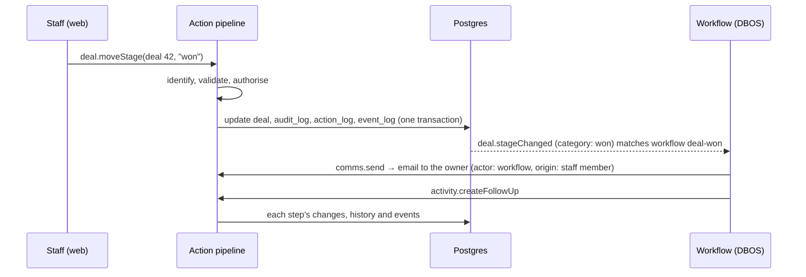

# System design

A simplified design for the factory core: how the repos are structured, what the database starts with, what each part of the system does, how the parts work together, and how agents use it both to build systems and to serve the people who use them.

Status: design. Names (`Factory`, `@workspace/*`, `fx`) are placeholders. Examples use the CRM example system.

---

## 1. The big picture

A client system is a small repo on top of versioned core packages. It deploys as three things: an API service, a static web front end and a Postgres database.


Three rules hold everything together:

1. **Every change to data goes through an action.** The web surface, agents, external systems and workflows all call the same actions, so permissions, validation, history and events always apply.
2. **Every definition lives in the repo.** Objects and actions are TypeScript. Workflows and the rest of config are YAML files. The database holds data, never definitions.
3. **Everything is derived one way.** Definitions produce the schema, the API, the screens and the agent tools. Nothing is maintained twice, so nothing can drift.

---

## 2. Repos

### The core monorepo

```
factory/
  apps/
    web/          the staff web surface (TanStack Start in SPA mode, shadcn)
  packages/
    ui/           shared shadcn components used by the web surface
    db/ objects/ actions/ config/ workflows/ events/ auth/ server/ sdk/ testing/
  modules/        comms, documents, payments, reports
  tools/fx/       the factory CLI and its MCP server
  templates/client/
  examples/       crm, bookings, cases (example systems, also used as test fixtures)
  docs/           this design, the decision records
```

Packages are named `@workspace/<name>`. They depend in one direction: `server` and `apps/web` → `workflows`, `config` → `actions` → `objects` → `db`. Modules depend on packages, never the other way round. `apps/web` talks to the server only through the HTTP API, like any other client.

### A client repo

```
acme-crm/
  system.ts                     defineSystem: core version, modules switched on, everything registered
  objects/
    organisation.ts
    contact.ts
    deal.ts
    activity.ts
  actions/
    deal.move-stage.ts
    activity.create-follow-up.ts
  config/
    choices/deal-stages.yaml
    fields/contact.yaml          staff custom fields
    roles/sales.yaml
    approvals/discounts.yaml
    workflows/deal-won.yaml
    templates/email/deal-won.yaml
    pages/pipeline.yaml
    flags/forecasting.yaml
  migrations/                    generated, one per change
  seed/                          fixtures for local and preview databases
  fx.config.ts                   git remote, hosting, environments
  package.json                   pins @workspace/* versions
```

```ts
// system.ts
export default defineSystem({
  name: "acme-crm",
  modules: [comms(), documents()],
  objects: [organisation, contact, deal, activity],
  actions: [moveDealStage, createFollowUp],
});
```

---

## 3. Starting database schema

Two kinds of tables: **core tables**, owned by the core and the same in every instance, and **object tables**, generated from each client's `defineObject` definitions. DBOS and Better Auth also keep their own tables in their own schemas.

### Core tables

```sql
-- Who can act
users              id, name, email, status, created_at        -- people who sign in (Better Auth)
actors             id, kind (staff | agent | integration | automation), name,
                   user_id, status, created_at
actor_roles        actor_id, role_key                   -- roles are defined in config
api_keys           id, actor_id, key_hash, label, last_used_at, revoked_at

-- What happened
action_log         id, name, actor_id, origin_user_id, run_id, input jsonb, result jsonb,
                   error jsonb, status (pending_approval | succeeded | failed | rejected),
                   retry_key, dry_run, config_sha, created_at, completed_at
audit_log          id, object, record_id, before jsonb, after jsonb,  -- changed fields only
                   action_id, actor_id, at
approvals          id, subject (action | draft), subject_id, rule_key, approver_role,
                   status (pending | approved | rejected | cancelled),
                   requested_by, decided_by, comment, created_at, decided_at

-- Events and workflows (DBOS keeps its own execution state alongside these)
event_log          id, type, payload jsonb, action_id, origin_user_id, depth,
                   created_at, dispatched_at
workflow_runs      id, workflow_key, config_sha, event_id, trigger jsonb,
                   origin_user_id, depth,
                   status (running | waiting | completed | failed | cancelled),
                   started_at, finished_at
workflow_step_runs id, run_id, step_id, action_id, input jsonb, output jsonb,
                   error jsonb, attempt, started_at, finished_at

-- Config bookkeeping (config itself lives in git)
config_versions    sha, status (loaded | rejected), errors jsonb, loaded_at
drafts             id, branch, title, files text[], status (draft | valid | invalid |
                   awaiting_approval | published | abandoned),
                   base_sha, created_by, published_sha, synced_sha,
                   created_at, published_at
```

### Object tables

Every object table gets standard columns from `defineObject`, plus its own fields:

```sql
id           uuid (v7) primary key
created_at, updated_at, created_by, updated_by
archived_at  -- records are archived, not deleted
version      integer -- optimistic concurrency
custom_fields jsonb  -- only when customFields: true; indexed for filtering
```

For the CRM example system:

```sql
organisations  name, website, industry (choice), owner_id → actors
contacts       first_name, last_name, email, phone, organisation_id → organisations
deals          title, organisation_id, contact_id, value (money), stage (choice),
               expected_close, owner_id
activities     deal_id, contact_id, type (choice), note, due_at, done_at
```

Money is stored as integer minor units with a currency. Choice fields store the option key.

---

## 4. Components

Each component below covers what it does, how it works, and what it connects to.

### 4.1 Objects and the data access layer (`@workspace/objects`)

**What it does.** Defines record types once, and gives everything else a safe way to read them.

**How it works.**

```ts
export const deal = defineObject({
  name: "deal",
  label: "Deal",
  fields: {
    title: f.text({ required: true }),
    organisation: f.ref("organisation", { required: true }),
    contact: f.ref("contact"),
    value: f.money(),
    stage: f.choice(dealStages), // defineChoiceList, section 4.5
    expectedClose: f.date(),
    owner: f.ref("actor"),
  },
  customFields: true,
  list: ["title", "organisation", "value", "stage"],
  actions: { update: { readOnly: ["stage"] } }, // stage moves only through deal.moveStage
  drizzle: (t) => [index().on(t.stage, t.owner)],
});
```

- `defineObject` returns a real Drizzle table, so drizzle-kit, migrations and typed queries work as normal.
- The **field types library** (about 12 types to start) gives each type its column, Zod rule, form input, list display and filters.
- The **data access layer** is the only way to read records: list, get, filter, sort, search, and follow relations. It applies permission filters, adds custom fields, and hides archived records unless asked.
- **Repositories** are the only way to write. They are only called from inside actions (see 4.2).

**Connects to.** Actions (generated actions and queries), the web surface (generated screens), config validation (which fields and choices exist), and migrations.

### 4.2 Actions and the action pipeline (`@workspace/actions`)

**What it does.** Every change is a typed action; every read is a typed query. This is the single path into the system.

**How it works.**

```ts
export const moveDealStage = defineAction({
  name: "deal.moveStage",
  description: "Move a deal to another pipeline stage",
  input: z.object({
    dealId: z.string(),
    stage: z.string(),
    reason: z.string().optional(),
  }),
  output: z.object({ deal: deal.schemas.record }),
  emits: { "deal.stageChanged": stageChangedSchema },
  async handler(ctx, { dealId, stage, reason }) {
    const option = ctx.config.choice(dealStages).get(stage); // validated, not archived
    if (option.category === "lost" && !reason) {
      return ctx.invalid("A reason is required for lost deals");
    }
    const result = await ctx.repo.update(
      deal,
      dealId,
      { stage },
      { lock: true }
    );
    if (result.status === "not_found") return ctx.notFound("deal", dealId);
    if (result.status !== "updated")
      return ctx.conflict("The deal can't move now");
    ctx.emit("deal.stageChanged", {
      dealId,
      from: result.before.stage,
      to: stage,
      category: option.category,
    });
    return { deal: result.record };
  },
});
```

- Handlers get everything through `ctx`: `repo` (writes, bound to the run's transaction), `dal` (reads), `config`, `clock`, `actor`, `emit` and the error helpers. Expected failures are returned as typed errors (validation, permission, approval required, conflict, not found), not thrown. Queries get the same `ctx` without `repo` and `emit` (decision 0019).

Every action, whoever calls it, runs the same pipeline in one database transaction:

```
1. Identify       who is acting (actor) and the person who started the chain
2. Validate       input against the Zod schema
3. Retry key    same key seen before? return the earlier result
4. Authorise      check the actor's permissions for this action
5. Approve?       if an approval rule matches, park as pending_approval and stop;
                  the last approval runs it, once, as the actor who asked
6. Run            the handler, using repositories (dry run rolls back here)
7. Record         field history for every changed record, the action_log row, event_log rows
8. Commit         all of the above together, or none of it
```

- Generated actions (`deal.create`, `deal.update`, `deal.archive`, `deal.restore`) and queries come from each object, and are on by default. When a hand-written action owns one of these (`actions: { create: 'booking.place' }`) the generated one switches off; when a hand-written action owns a field, the generated update marks it read-only.
- The `action_log` table records every action: who did it, the person who started the chain, the input, the config version and what happened.
- Actions declare the events they emit (`emits: { 'deal.stageChanged': schema }`); generated actions emit `<object>.created`, `.updated`, `.archived` and `.restored`. Actions are named as verbs, events in the past tense.

**Connects to.** Everything. The HTTP API, MCP, CLI, web surface, workflows and external systems all call actions. Actions write through repositories and emit events.

### 4.3 Identity and permissions (`@workspace/auth`, `@workspace/actions`)

**What it does.** Knows who is acting and what they may do.

**How it works.**

- **Users** are people who sign in. **Actors** are whoever performs an action: staff (a user acting directly), agents, integrations (a client's website, another system) and automation (each workflow is its own actor; backfills run as a system automation actor).
- **Staff** sign in through Better Auth: the client's Microsoft or Google SSO, with a magic link or one-time code as fallback.
- **People act as themselves.** A staff member's actions are checked against their roles.
- **Agents act for a person,** with permissions no wider than that person's.
- **Workflows act as themselves,** with permissions worked out from the actions their steps run (see 4.6). Only someone who holds every one of those permissions can publish the workflow.
- **Integrations** use API keys from their own servers, scoped to a few actions and queries, and rate limited.
- **Every action records two people-facing facts:** `actor_id` (who performed it: Sarah, an agent, a workflow) and `origin_user_id` (the person at the start of the chain, copied down through every workflow and step). Steps inside a run also record `run_id`.
- **Roles and permissions are config:**

```yaml
# config/roles/sales.yaml
key: sales
label: Sales
permissions:
  - { object: organisation, can: [view, create, update], scope: all }
  - { object: deal, can: [view, create], scope: all }
  - { action: deal.moveStage, scope: all }
```

Every permission carries a `scope`. Version one supports only `all`, which works as plain role permissions. Later scopes (`own`, `assigned`, `team`) are added in the data access layer without changing existing permissions.

Approval rules are config too (decisions 0042 and 0043):

```yaml
# config/approvals/large-payments-senior.yaml
key: large-payments-senior
label: Large payments, senior sign-off
action: payment.release
record: { object: payment, id: input.id } # conditions can read the record
when: # every condition must hold
  - { field: record.amount.currency, operator: eq, value: GBP }
  - { field: record.amount.amount, operator: gt, value: 100000 } # minor units
approver: senior
approvals: 1 # how many different people
requester: [junior, manager] # optional: whom it asks
exempt: [senior] # optional: who skips it; the approver role by default
```

A rule names an action, with conditions on its input (`input.…`) or its record (`record.…`), or the config types (`config: [roles, choices]`) a draft can't publish without sign-off. Tiers are several rules: a large payment can match a manager rule and a senior rule, and waits for both. Agents always need a person. Staff with the role decide through `approval.approve` and `approval.reject`; nobody decides their own request or their agent's, and each approval on one subject is by a different person. Before an approved action runs, the rules are checked again, so one that came to need more approval while it waited doesn't run.

**Connects to.** The pipeline (authorise step), the data access layer (filters), approvals, and config (roles are files).

### 4.4 Config (`@workspace/config`)

**What it does.** Keeps every staff-editable definition as a file in git, lets staff change it safely through the web surface, and loads it into the running system without a deploy.

**How it works.**

- **Config types.** Each type (choice, field, role, approval, workflow, template, page, flag) has a Zod schema registered by the core or a module. Files live under `config/<type>/<key>.yaml`, in plain YAML 1.2 (decision 0037).
- **Validation.** One `validateConfig` function validates every file against its schema, then cross-checks references against the running code: objects, fields, choice options, actions, events, templates and roles. It runs in the dev server, in CI, in the web surface on every draft, and in the loader.
- **The loader.** On start-up and on each new commit to the branch it runs (`production` in production, `main` on staging), the instance fetches `config/`, validates it against its own code, and swaps an in-memory index in one go. It records the commit in `config_versions`. Config that fails validation is refused; the last good version stays live and the failure is flagged.
- **Pinning.** Workflow runs and actions record the config commit they ran under.
- **Locally,** the dev server watches `config/` and reloads instantly, with no git involved. To try drafts locally, `CONFIG_REMOTE=local` makes a bare repository in `.factory/` from `config/` the first time and runs against it instead; edits to `config/` are then not seen until that folder is removed.

**A staff draft can change several files at once, and publishes them together:**

```
1. Staff change a setting; their first save opens their working draft (or an agent calls draft.open or draft.save over MCP)
2. The config service makes a short-lived branch from production and commits each edited file
3. Every save is validated against the running code; problems show in the form. Edits can be undone one file at a time, or the draft discarded
4. Publish: if an approval rule covers any file in the set, it asks the approvers instead, and the last approval publishes it as the person who asked
5. The draft's files go onto production in one commit; a bot copies them back to main
6. The loader sees the commit, validates, swaps the index; new runs use it in seconds
```

Whoever asked for approval, or the person their agent acts for, can withdraw the request, and `approval.check` says beforehand whether an action or a draft needs sign-off and from whom (decision 0044).

In the web surface, a pill in the header shows the caller's unpublished edits, or that they wait for approval, with Undo, Publish (or "Request approval from …") and Discard; Config → Drafts edits choice lists and roles as forms and shows a draft's changes in plain English ("Adds the option “Negotiation”", "Can now archive deal"); a save sends the file's value and the server writes the YAML (`draft.save` with `value`, read back with `draft.files`). Other types are edited as YAML through the API for now.

The config service uses plain git (clone, branch, commit, push, fetch) against any remote, so it is not tied to GitHub. Publishing refuses a draft whose files production changed since it began, and the copy to main is skipped, not forced, when main changed them (decision 0041).

**Connects to.** Objects (choice and field definitions), permissions (roles), approvals, workflows, comms templates, pages, and the web surface's config editors.

### 4.5 Choice fields

**What it does.** Dropdown-style fields whose options staff can manage, without breaking code that depends on them.

**How it works.** A choice list is defined in code: its key, its own columns (each a Zod schema) and, when code acts on specific options, its fixed keys. Its rows live in `config/choices/<list>.yaml`, where staff edit them. Every option has a key (stored on records), a label (what people see), an optional description (hints, tooltips and agents) and an archived flag, plus the list's own columns (decision 0040).

```ts
export const dealStages = defineChoiceList({
  key: "deal-stages",
  columns: { category: z.enum(["open", "won", "lost"]) }, // code acts on the category
});
export const bookingStatus = defineChoiceList({
  key: "booking-status",
  keys: ["pending", "confirmed", "cancelled"], // code acts on each key
});
export const industries = defineChoiceList({ key: "industries" }); // code acts on nothing
```

| The list has | Staff can | Code acts on | Example |
| --- | --- | --- | --- |
| Fixed `keys` | Rename labels, change column values | Specific keys | Booking status |
| Columns code reads | Add, rename, reorder, archive; set each option's columns | Column values | Deal stages: open, won, lost |
| Neither | Anything | Nothing | Activity type, industry |

```yaml
# config/choices/deal-stages.yaml
key: deal-stages
options:
  - { key: lead, label: Lead, category: open }
  - {
      key: qualified,
      label: Qualified,
      category: open,
      description: Budget and decision-maker confirmed,
    }
  - { key: proposal, label: Proposal sent, category: open }
  - { key: won, label: Won, category: won }
  - { key: lost, label: Lost, category: lost }
```

- Staff change rows, never a list's structure: a new column ships with the code that reads it, as optional first, like a migration.
- A new value whose behaviour is in code ships with that code. A new value whose behaviour is config (a workflow or approval rule) is added by staff in the same draft as that config.
- Options in use are archived, never deleted. Archiving one that config still references is blocked.

### 4.6 Workflows (`@workspace/workflows`)

**What it does.** Reacts to events, schedules or a manual start by running steps, durably, with a full record of each run. Workflows are the only thing that reacts to events.

**How it works.**

- **Workflows are config.** One file per workflow, built from steps. By convention there is one workflow per event ("When a booking is cancelled"), so there is one place to look; a second is allowed when part of the behaviour needs separate failure handling.

```yaml
# config/workflows/booking-cancelled.yaml
key: booking-cancelled
label: When a booking is cancelled
trigger: { event: booking.cancelled }
steps:
  - id: refund
    action: payments.refund
    inputs: { bookingId: { from: trigger.bookingId } }
  - id: email
    action: comms.send
    inputs:
      {
        template: { value: cancellation },
        to: { from: trigger.customer.email },
      }
  - id: notify-website
    action: http.send
    onFailure: continue
    inputs:
      url: { value: https://campsite.example/hooks/factory }
      secret: { value: secret://hooks/campsite-website }
      body: { from: trigger }
```

- **Every step either runs an action or controls flow.** Action steps (`action: payments.refund`) go through the full action pipeline. Control steps are `condition`, `wait` and `waitForApproval`. There is no other kind of step, so every side effect, including sending email and calling a URL, is a permission-checked, logged action.
- **Inputs** are either mapped from earlier data (`from`) or fixed (`value`). Conditions are field, operator, value: no expression language.
- **Calling outside systems** uses the `http.send` action: signed payload, standard envelope, retries with backoff, response recorded. The URL must be a fixed value in the file, never taken from data.
- **Failure handling** is per step: `onFailure: stop` (default) or `continue` (default for `http.send`), so a slow website never holds up the rest.
- **Triggers:** an event, a schedule, or a manual start from the web surface or an agent.

**Who a workflow acts as**

- **Workflows act as themselves.** Each workflow is an automation actor. Its permissions are worked out from its steps (for example "refund payments, send email, call campsite.example"); nobody writes a role for it.
- **Publish guard.** Whoever publishes or approves the workflow must hold every one of those permissions. Any edit recalculates the list and checks again.
- **Manual starts** need permission to run that workflow; the workflow then acts as itself.
- **Approval rules apply to workflows too.** If a step's action needs approval, the run waits durably until someone approves or rejects it.
- **Authority review.** The web surface lists workflows whose publisher or approver no longer holds a permission the workflow uses, so they can be re-approved or turned off.
- **Dry run before publishing.** A draft workflow can be run against a sample event with every action in dry-run mode, showing each step, its result and any missing permission.

**How runs happen**

- **The dispatcher** reads new `event_log` rows, finds the workflows whose trigger matches, and starts one DBOS run per event and workflow, so each pair runs exactly once.
- **One DBOS workflow interprets every definition.** It loads the pinned definition, resolves inputs, runs each step as a durable DBOS step, and records it in `workflow_step_runs`. Waits and approvals use DBOS durable sleep and events, so a run survives restarts.
- **Loops are capped.** Each run carries a depth count from the event that started it, and dispatch stops past a limit.
- **Visibility.** Each object gets a "What happens when…" view grouping workflows by trigger event, and every record's timeline shows the runs it caused, step by step.

**Connects to.** Events (triggers), actions (every step with a side effect), config (definitions), permissions and approvals, and the web surface (run inspector, "What happens when…").

### 4.7 Events (`@workspace/events`)

**What it does.** Records what happened and hands it to workflows.

**How it works.**

- **An action is a request; an event is a fact.** Actions are named as verbs (`booking.cancel`) and can fail. Events are named in the past tense (`booking.cancelled`) and exist only when an action succeeded.
- **Event types are declared in code,** on the actions that emit them, with a payload schema. They can be listed through introspection; there is no event-types table.
- Actions write events to `event_log` in the same transaction as the change, so an event exists if and only if the change happened.
- **Nothing listens unless a workflow's trigger names the event.** The event never knows who is listening; the web surface finds listeners by searching the loaded config.
- **Calls from outside** (for example Stripe webhooks) are HTTP routes mapped to actions, run as integration actors, with the provider's event ID as the retry key. There are no webhook tables: calls in are actions, calls out are `http.send` steps.

**Connects to.** Actions (source) and workflows (the only listeners).

### 4.8 History and audit

**What it does.** Answers "who changed what, when, why, and through which channel" for every record.

**How it works.** Repositories write it, inside the action pipeline, not database triggers:

- each update reads the current row, applies the change, compares old and new field by field (custom fields per key), and writes one `audit_log` row holding the changed fields `before` and `after` (decision 0018);
- a create writes one row with an empty `before`; a change that changes nothing writes none;
- the action_log row, audit_log rows and events commit together;
- housekeeping columns are skipped; the API's database role is the only writer, and backfills run as actions under the automation actor.

The web surface shows a timeline on every record, built from `audit_log` and `action_log`.

### 4.9 Surfaces (`@workspace/server`, `apps/web`, `@workspace/sdk`)

All surfaces are generated from the same registry of objects, actions, queries and config types.

| Surface | For | Built from |
| --- | --- | --- |
| HTTP API + OpenAPI | The web surface, external systems | A route per action and query, with the Zod schemas |
| MCP server | In-app and external agents | A tool per action and query the actor may call, plus config and introspection tools |
| Web | Staff | Generated list and record screens per object, forms from action inputs, config editors, drafts and approvals inbox, run inspector, record timeline |
| SDK | Developers of external systems | Generated from the OpenAPI spec |

The web app has no data access of its own: every screen calls the HTTP API as the signed-in user (decision 0032). Its header holds navigation by section, with breadcrumbs below, and the sidebar is kept for the in-app agent (decision 0033). Each section and item appears only when `system.describe` says the caller can use what it needs:

| Section | What it has |
| --- | --- |
| Data | A list, record and create screen per object; archive and restore; each record's history |
| Inbox | Approvals: each pending action or draft, what it would do, who asked, and Approve and Reject |
| Activity | The action log (each action's input, result, changes and events), every change across records, and the event log |
| Access | Users (invite, roles, disable), agents, integrations and their keys, and roles |
| Config | Drafts: edit choice lists and roles into your working draft, review a draft's changes in plain English, publish (or request approval), withdraw and discard. The header's draft pill shows your unpublished edits |
| Settings | Reference (the system as `system.describe` gives it to you) and API & MCP |

The account menu has My agents, where staff connect an MCP client with a key of their own. The run inspector joins these sections with workflows.

Local development adds a dev bar above the app, and production builds leave it out. It is for working on the factory, never for configuring a system. Its menus are:

- **Factory:** the change, branch and database.
- **Session:** sign in as any user from the server's dev outbox.
- **API:** recent calls, dry runs, added latency and forced errors.
- **Inspect:** TanStack devtools and the raw description.
- **Design:** animation speed.

The page builder (phase 4) adds staff-composed pages from blocks over the same queries and actions. The pages are config files.

### 4.10 Modules

**What it does.** Packages optional capability: comms, documents, payments, reports.

**How it works.** A module uses the same building blocks as a client repo and registers through one contract:

```ts
export const comms = () =>
  defineModule({
    name: "comms",
    objects: [emailSend],
    actions: [send], // comms.send, usable as a workflow step
    configTypes: [emailTemplate],
    events: ["email.sent", "email.failed"],
    screens: [templatesScreen],
  });
```

A client's `system.ts` switches modules on. Its tables exist only in instances that use it.

---

## 5. How it fits together

### A staff member wins a deal



If Claude Code does the same thing over MCP, the only difference is the first line: the actor is an agent acting for a person. Either way, the workflow's actions record the workflow as actor and the person who moved the deal as origin.

### Staff add a stage and an email for it

A sales manager adds the stage "Negotiation" (category: open) and a workflow that emails the sales director when a deal enters it. Both go into one draft: the web surface commits both files to a branch from `production`, validates them together, the manager publishes, and the loader picks up the commit. It's live within seconds, with no deploy, and the bot copies it back to `main`.

### A developer adds a feature

You run `fx start "deal forecasting"`, add a `forecast` field and a `deal.forecast` action, and a flag file to keep the screen hidden. `fx dev` applies schema edits to the change's own database as you go. `fx ship` generates one migration, runs every check and opens the PR. It merges to `main` and staging when green, and reaches production at the next release you approve: migrations first, then code, then config from the same commit.

---

## 6. Delivery

### Branches and environments

| Branch | Runs on | Receives |
| --- | --- | --- |
| Change branches | Local, preview | One change each, merged into `main` within hours or days |
| `main` | Staging | Every merged change; staff publishes copied back by the bot |
| `production` | Production | Releases promoted from `main`; staff publishes |

### Migrations

- No migration files while working on a change: schema edits are pushed to the change's own database.
- `fx ship` generates the change's migration: one for the core and one for each system whose schema changed, each system keeping its own after the core's (decision 0036). CI applies them to a fresh database and a copy of seeded data.
- Merge applies it to staging; release applies it to production before the new code starts.
- **Expand, then contract:** migrations must work with the code already running. Destructive operations are linted and allowed only as the marked contract step.
- Staff never trigger migrations: custom fields live in JSONB `custom_fields`.

### Guardrails

- `fx` does the chores: branches, worktrees, databases per change, migrations, rebases and clean-up.
- CI and branch protection enforce: no pushes to `main` or `production` without a PR and green checks; only the release bot writes to `production`.
- Checks on every change: types, lint, unit tests, `validateConfig`, migration lint and dry run, generated contract tests, preview smoke tests.
- The schema check compares the database schema with the object definitions at start-up, and every table must come from `defineObject`.

---

## 7. Agents

Agents use the system in two ways, through one set of tools.

### Building systems (development)

Agents work like a developer with `fx`, either as the CLI or as `fx`'s MCP tools, inside a client repo or the core repo.

| Tool group | Examples |
| --- | --- |
| Changes | `fx start`, `fx switch`, `fx ship`, `fx status` |
| Introspection | `fx describe` lists objects, fields, actions, events, config types and their schemas |
| Scaffolding | `fx add object`, `fx add action`, `fx add config workflow` |
| Checks | `fx check` runs types, tests, `validateConfig` and migration lint locally |

The repo's `AGENTS.md` sets the rules: use `fx`, never raw git or Drizzle; every capability is an action; every table is a `defineObject`; every change ships with tests. A typical ticket is: describe, scaffold, implement, check, ship. CI is the final word.

### Serving staff (operation)

At runtime, agents connect to an instance's MCP server as an actor acting for a person.

| Tool group | Examples | Who can use it |
| --- | --- | --- |
| Operate | `deal.moveStage`, `contact.create`, start a workflow, approve | Whatever the actor's permissions allow |
| Query | Search and read records, history, workflow runs | Filtered by the same permissions |
| Configure | List config types, draft, validate and publish drafts, withdraw requests | Config permissions; approval rules still apply |
| Introspect | Describe objects, actions, choices, workflows | Anyone signed in |

- **The in-app agent** (phase 4) is a client of this MCP server running as the signed-in staff member. It has no tools an external agent with the same permissions lacks.
- **External agents** (Claude Code, Cursor or the client's own) connect with the same tools. With repo access as well, they can also develop.
- **Everything an agent does is an action,** recorded with the agent as actor and the person as origin, and subject to the same approvals.

---

## 8. Not in the core

- Customer-facing UI and customer logins: public sites are separate front ends calling the API.
- Multi-tenancy inside an instance: each client has their own instance.
- A general expression language in config: new behaviour is a new step or action in code.
- Database triggers for business logic or history.

---

## 9. Stack

Plain TypeScript on boring, popular tools. Decision record: [0008](decisions/0008-plain-typescript-effect-deferred.md).

| Layer | Choice | Notes |
| --- | --- | --- |
| Language and runtime | TypeScript on Node 26 LTS | Strict mode everywhere |
| HTTP | Hono | Routes are generated from the action registry |
| Validation and contracts | Zod 4 | One schema per action drives validation, OpenAPI, MCP tools and forms |
| API transport | Our own generator on Hono | Routes, OpenAPI and MCP tools from the registry; decision [0026](decisions/0026-api-transport-own-generator-on-hono.md) |
| Durable workflows | DBOS Transact | Needs only the program and Postgres |
| Database | Postgres and Drizzle | Start on current stable; move to v1 when it is stable |
| Auth | Better Auth | Client SSO plus magic link |
| MCP | Official TypeScript MCP SDK | Tools generated from the action registry |
| Web surface | TanStack Start in SPA mode, TanStack Router, Query, Table and Form; shadcn on Base UI | From the template; no server functions for data, everything goes through the HTTP API |
| AI and in-app agent | Vercel AI SDK; harness still open | Phase 4 |
| Git from the server | git command-line tool |  |
| Config files | YAML via the `yaml` package | Rewrites files without losing comments |
| Tests | Vitest on real Postgres | Plus generated contract tests |
| Monorepo | pnpm and Turborepo |  |
| Observability | OpenTelemetry |  |

**Effect is deferred, not rejected.** In Effect 4.0 the HTTP, HttpApi, SQL, RPC, workflow, cluster, AI and observability modules are marked unstable, workflows are less mature than DBOS, agents need the Effect source vendored to write correct v4 code, and client developers would have to learn it at handover. Code is written so a later move stays cheap:

- actions return typed error results instead of throwing;
- services (repository, config, clock, git) arrive through the action context, never by direct import;
- one place in the core owns retries, timeouts and tracing.

A one-week trial after phase 1 rebuilds the action pipeline, one route, one MCP tool and one workflow in Effect 4 and compares them on agent first-time success, lines of code, readability for a newcomer and unstable APIs touched.

---

## 10. Glossary

| Term | Meaning |
| --- | --- |
| **Object** | A record type, such as Deal or Contact, defined with `defineObject`. |
| **Record** | One instance of an object: a row in its table. |
| **Field type** | A kind of field (text, money, date, choice, reference and so on) that knows its column, validation, input and display. |
| **Custom fields** | Fields staff add to an object through config, stored in the record's `custom_fields` column. |
| **Choice field** | A dropdown field whose options come from a choice list. |
| **Choice list** | A list of options defined in code with `defineChoiceList` (its own columns, and any keys code acts on) whose rows staff edit in `config/choices/`. |
| **Action** | Anything that changes data, defined with `defineAction`. Generated ones (create, update, archive, restore) come with each object. |
| **Query** | Anything that reads data, defined with `defineQuery`. |
| **Action pipeline** | The fixed sequence every action runs through: identify, validate, retry check, authorise, approve, run, record, commit. |
| **Action registry** | Every action and query, from which every surface is generated. |
| **Surface** | A way into the system: the HTTP API, MCP, the CLI or the web. All are equal clients of the action registry. |
| **Repository** | The only code that writes records; called only from inside actions. |
| **Data access layer** | The only code that reads records; applies permissions and scopes. |
| **User** | A person who signs in. |
| **Actor** | Whoever performs an action: staff, an agent, an integration or automation. |
| **Origin user** | The person at the start of a chain of actions, recorded on every action so "who started this" is always answerable. |
| **Role** | A named set of permissions, defined in config. |
| **Permission** | One line in a role: which object or action, what can be done, and the scope. |
| **Scope** | Which records a permission covers. Only `all` in version one. |
| **Approval rule** | When an action or a draft needs sign-off, and from whom. |
| **`action_log`** | Every action run: who, for whom, input, result, config version. |
| **`audit_log`** | Every change to every record: one row per record per action, with the changed fields `before` and `after`, which action, which actor. |
| **Event** | A fact that something happened, named in the past tense, declared on the action that emits it. |
| **`event_log`** | Every event, written by actions and dispatched to workflows. |
| **Config** | Staff-editable definitions kept as files in git: choices, fields, roles, approvals, workflows, templates, pages, flags. |
| **Config loader** | Loads config from git into the running system and swaps it in without a deploy. |
| **Draft** | A staff edit of one or more config files, validated, approved if needed, then published together. |
| **Workflow** | A config file describing steps that run when an event, schedule or manual start triggers it. The only thing that reacts to events. Acts as itself, with permissions worked out from its steps. |
| **Step** | One line of a workflow: either runs an action or controls flow (condition, wait, wait for approval). |
| **Dispatcher** | Starts one workflow run per matching event and workflow. |
| **Module** | An optional package of objects, actions and config types, such as comms or payments. |
| **System** | One client's system: a client repo with `defineSystem`, deployed as its own instance. |
| **Change** | One developer unit of work: ticket, branch, worktree, local database, preview and PR, managed by `fx`. |
| **`main`** | The next release; staging runs it. |
| **`production`** | What production runs; releases promote `main` into it, and staff drafts publish to it. |
| **Sync bot** | Copies every staff publish from `production` back into `main`. |
| **Schema check** | Start-up and CI check that the database matches the object definitions. |
| **Example systems** | The CRM, bookings and cases systems used to design and test the core. |
